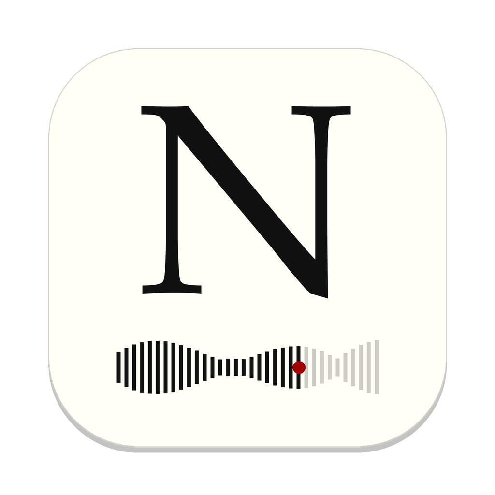

# Pausetape

<p align="center"></p>

*Like the tapes once made from the radio, pause button at the ready: your own selection, for the
road.*

A desktop app that organises your music for the **Snowsky Echo Mini** running the
[RECHO](https://recho.atzkey.workers.dev/) firmware, and plays it on your computer in a quiet,
Tufte-inspired player.

**Website, with a step-by-step tour and downloads:** <https://cese04.github.io/pausetape/>

RECHO is fast, but it reads the SD card as it is: it browses folders sorted by name, has no
playlists, and plays only FLAC, MP3 and WAV. Pausetape turns a music folder (organised or not)
into exactly the layout RECHO browses well:

```
Artist/
  1997 - Album/
    01 - Title.flac
    1-01 - Title.flac        (multi-disc)
Various Artists/Compilation/03 - Track Artist - Title.mp3
_Playlists/Road Trip/01 - Artist - Title.flac   (+ Road Trip.m3u8)
```

## What it does

- **Reads your music where it is.** Any folder, tidy or not. Tags first, folder names as a
  fallback. The library opens at once from its database; the folder is read again when you
  ask (or change it), and then only new or changed files are opened.
- **Fixes artist names.** "The Beatles" / "Beatles, The", "AC/DC" / "ACDC", "Beyoncé" /
  "Beyonce" merge automatically; likely typos are suggested for you to confirm.
- **Suggests tags from MusicBrainz**, applied only when you accept them.
- **Leads to more of an artist's music.** Open an artist for their genres and years and links
  to buy it (Bandcamp, Qobuz, Discogs…), hear it first (Spotify, Tidal…) and find what's
  related (last.fm, Rate Your Music), from MusicBrainz.
- **Writes to the card the way you want it.** Saved *card setups* choose which artists, albums
  and playlists go on a card, what they're called there and in what order. Each Sync copies only
  what changed and removes only files it put there itself.
- **Playlists for a player without playlists:** folders of numbered copies (FAT/exFAT cards
  can't hold symlinks).
- **Plays almost anything**, including Dolby Atmos (E-AC-3) releases via ffmpeg, and marks
  clearly what the Echo Mini can't play.
- **Converts for the card** what the Echo Mini can't play: ALAC, AIFF, APE and other lossless
  files become FLAC, with nothing lost; AAC, Dolby and other lossy files become MP3 320.
- **Albums stored as one file plus a `.cue` sheet** show as separate songs, as in foobar2000
  or AIMP. On the card, each song becomes its own FLAC file.
- **Several copies of an album** (rips, reissues) are recognised as editions; one goes on the
  card, and you choose which. Copies that another copy covers in the same or higher quality
  are pointed out, so you can remove them if you like.
- **Cover art in the songs:** when a cover is only an image in the folder, the player offers to
  embed it, so the Echo Mini shows it.

## Status

Early: 0.1.0 is the first release. Developed and used most on **macOS**, tested by hand on
**Windows 11**; **Linux** builds and passes its tests, but hasn't been run on a desktop yet.
Details: [docs/PROGRESS.md](docs/PROGRESS.md).

Downloads are on [Releases](https://github.com/cese04/pausetape/releases) (or the
[website](https://cese04.github.io/pausetape/), which picks the right one). None is signed yet,
so each system asks once whether to trust it.

| Platform | Download | State |
|---|---|---|
| macOS 12+ (Apple Silicon + Intel) | `Pausetape-<version>.dmg`, ffmpeg included | Works |
| Windows 10/11 (x64) | `pausetape-v<version>-Windows.exe`, one file, nothing to install | Works on Windows 11; what was checked is in [docs/TESTING.md](docs/TESTING.md) §3 |
| Linux (x86-64) | `pausetape-v<version>-Linux`, one file | Untested; known gaps in [docs/TESTING.md](docs/TESTING.md) §3 |

## Install

**macOS**

1. Open `Pausetape-<version>.dmg` and drag the app to Applications.
2. Open it once; macOS says it can't verify the developer. Click **Done**.
3. System Settings › Privacy & Security › **Open Anyway**. Only needed the first time.

**Windows:** run the `.exe`. If Windows says it protected your PC, click **More info**, then
**Run anyway**. For Dolby, Opus, APE, WavPack and WMA files, install ffmpeg:
`winget install Gyan.FFmpeg`.

**Linux:** `chmod +x pausetape-v<version>-Linux`, then run it. For the same rarer formats,
install ffmpeg from your distribution (`sudo apt install ffmpeg`).

### Build the Mac app

Needs Xcode Command Line Tools and `rustup target add x86_64-apple-darwin`; the first run also
compiles the bundled ffmpeg:

```sh
scripts/package-macos.sh      # → dist/Pausetape.app and dist/Pausetape-<version>.dmg
```

## Build from source (any platform)

Install Rust from <https://rustup.rs>, plus on Windows the Visual Studio C++ build tools, and on
Linux the audio/windowing headers (exact commands per distribution in
[docs/TESTING.md §1](docs/TESTING.md#1-set-up-the-build-tools)). Then:

```sh
cargo run --release                          # the app
cargo run --release -- --version             # version, and which ffmpeg it uses
cargo run --release -- --plan ~/Music        # dry run: print the planned layout, change nothing
cargo test                                   # offline tests
```

ffmpeg is optional outside the Mac app (`winget install Gyan.FFmpeg`, `sudo apt install ffmpeg`,
`brew install ffmpeg`). Without it, everything except Dolby, Opus, APE, WavPack and WMA plays.

## Documentation

| Document | For |
|---|---|
| [docs/PROGRESS.md](docs/PROGRESS.md) | What's built, how it was verified, known issues, roadmap and UI/UX ideas |
| [docs/NEXT.md](docs/NEXT.md) | Agreed next changes: safer MusicBrainz lookups, folder-name reading, CUE sheets |
| [docs/TESTING.md](docs/TESTING.md) | Testing on Windows and Linux, step by step, and how to report results |
| [docs/DISTRIBUTION.md](docs/DISTRIBUTION.md) | Packaging, signing and releases for macOS, Windows and Linux |
| [CONTRIBUTING.md](CONTRIBUTING.md) | How work is done: git flow branches, versions, what the CI keeps, open feature branches |
| [docs/WEBSITE.md](docs/WEBSITE.md) | The website (`site/`): its screenshots, the tour, publishing it |
| [docs/ARCHITECTURE.md](docs/ARCHITECTURE.md) | How the code fits together, where data is stored |
| [CHANGELOG.md](CHANGELOG.md) | Everything done so far, in order |

## License

[MIT](LICENSE). The macOS app bundles a minimal build of [FFmpeg](https://ffmpeg.org) (LGPL v2.1),
whose licence and build details are inside the app under `Contents/Resources/Licenses`. The app
brings its fonts, in [assets/fonts](assets/fonts) with their licences: ET Book (MIT), Courier
Prime and Kalam (SIL Open Font Licence).
