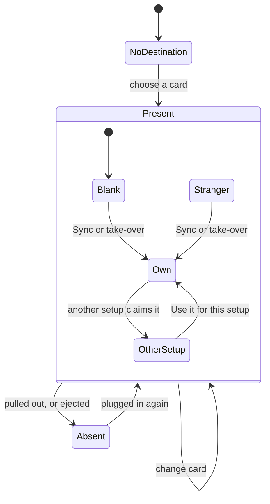
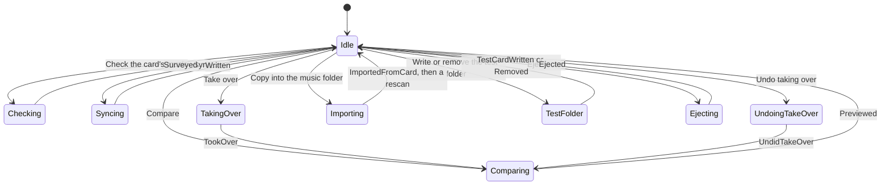
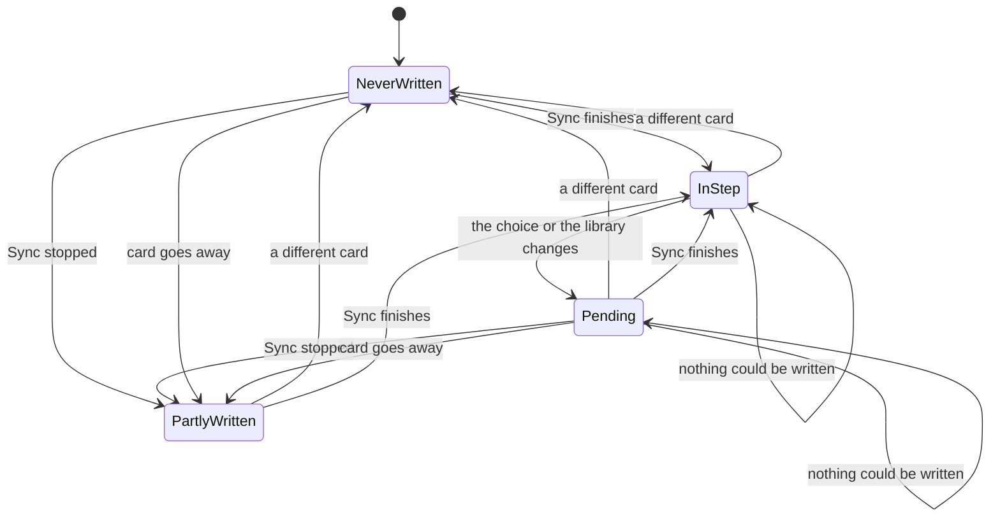
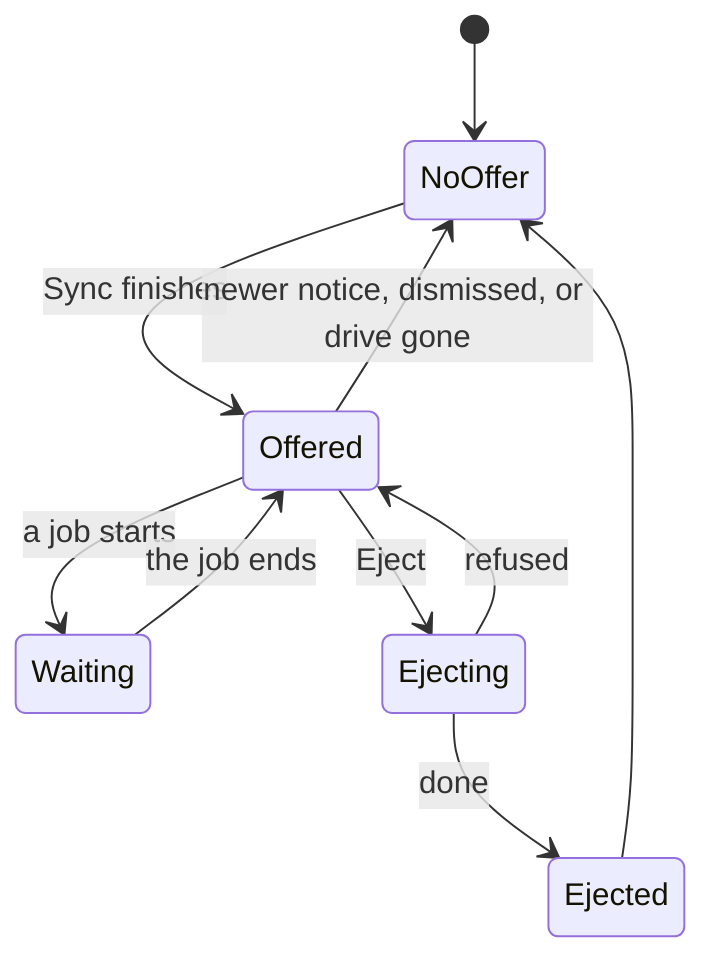

# The card as a state machine

Everything the app does with a removable card or stick: the states it can be in, what moves it
between them, and what each operation checks first. Written from the code on 2026-11-08, then
checked against it. [Section 7](#7-paths-not-handled-yet) lists the paths the code doesn't handle
yet.

"Card" means an SD card or USB stick; it can also be any folder chosen as the destination.

## 1. What the app knows about a card

The app knows a *path*, and what it finds there. A card is told from another by the id in its label.

| What | Where it lives | Kept between runs | Set by |
|---|---|---|---|
| `dest`, where the setup writes | `WriteProfile` | yes | the card picker; `card_arrived` |
| `manifest`, the files this setup put there | `WriteProfile` | yes | end of a Sync; take-over and its undo |
| `last_written` | `WriteProfile` | yes | end of a Sync that wasn't stopped |
| `.pausetape`, the label: which setup last wrote the card, and the card's own id | on the card | on the card | Sync; take-over; *Use it for this setup* |
| `card_id`, the card the manifest describes | `WriteProfile` | yes | the same three, once the label is written; cleared for a new card |
| `volumes`, the drives listed now | `App` | no | the watcher; after Sync and Eject |
| `mounted`, the drives seen last time | `App` | no | `saw_cards` |
| `card_look`, the active setup's card as last seen: there or not, space, label, test folder | `App` | no | the watcher; `refresh_label` |
| `reachable`, which setups' destinations could be reached | `App` | no | the same |
| `dest_label`, the label as last read | `App` | no | the same |
| `EJECTED`, drives not to be read for now | `card::volumes` | no | `App::eject`; the watcher lets go |
| `write_preview`, the last comparison | `App` | no | Compare (`Msg::Previewed`) |
| `card_survey`, what's on the card besides this setup's files | `App` | no | Check (`Msg::Surveyed`) |
| `busy`, the job running | `App` | no | each job |
| `eject_notice`, the notice offering Eject, and the drive | `App` | no | `offer_eject`; `Msg::Ejected` |

The card's id is made the first time it's labelled and kept whichever setup labels it again. A
setup follows one card: for a second card, *Duplicate* makes it its own setup.

`card::volumes` lists drives: `/Volumes` on macOS, `/media` and `/run/media` on Linux, and on
Windows removable and fixed drives other than Windows' own.

## 2. Machine A: the card, as a setup sees it

| State | Test in the code | What's allowed |
|---|---|---|
| NoDestination | `dest` is `None` | choose a card |
| Absent | `dest` set, and not there at the last look (`card_connected`) | choose a card; Sync and Compare are hidden |
| Blank | present, no label | everything |
| Own | label's id is this setup's | everything |
| OtherSetup | label names another setup on this computer (`refused_by_label`) | switch to it; relabel; Compare. No Sync, check or take-over |
| Stranger | label names a setup not on this computer | everything. Sync relabels it; only this setup's own files are ever removed |

`dest` is never cleared, only replaced. Which of these states applies is worked out when it's
needed; nothing stores it.

**Who looks at the card.** A thread of its own (`cards::watcher`), one look at a time, every 3
seconds or as soon as `look_soon` asks. A slow or failing drive delays the next look and nothing
else: the window draws from the last answer. Only what's about to act on the card, or has just
changed it, looks for itself on the interface thread (`card_missing`, `refresh_label`): what it
acts on must be what's there now.

An answer about another setup or card than the one asked about is dropped and asked for again.
That's what stops a look read before a Sync, on a blank card, from clearing the record the Sync
has just made.

**Noticing a card.** While a job runs, the drives are listed and arrivals wait, so a setup's `dest`
doesn't change under running work. Once the slot is free, a drive not in `mounted` whose top folder
holds a label counts as arrived. That covers every start, when opening the library holds the slot:

| Arrival | Result |
|---|---|
| Label's setup is here | `dest` follows the card; the setup comes up unless the active setup's own card arrived too; a notice says so, except for a card found at the start where it was expected |
| Label's setup isn't here | a notice only |
| No label | nothing; the card is chosen in the picker |

**A card going away** has no event of its own. `volumes` loses it, `mounted` follows and the
views change with the look. At that look, once no job runs (`forget_a_card_gone`), the comparison
and the check of its music are dropped, and the dialog going through them closes and says why.
Two things stay on purpose: the test folder's results, as the card comes out to try them on the
player, and the marks in the library, worked out from the manifest.

## 3. Machine B: the job slot

One job at a time, held in `busy`. Every job on the card takes the slot and gives it back when
its message arrives.

Library jobs (scan, tag writing, Trash) use the same slot, so none of these runs beside them.
Only Sync and Import can be stopped by the user. Replies name the setup by id, so switching
setups during a job is safe: a reply for another setup, or a deleted one, changes only that setup.

## 4. Machine C: what the record says about the card

The manifest is a claim about the card. This machine is about how far it can be trusted.

- **A different card at `dest`** (`refresh_label`, while idle, so also just before a Sync): its
  label's card id isn't the record's, or it has no label where this setup put one. The manifest,
  `last_written`, the card id and the take-over offer are cleared and a notice says so. Only a
  clear answer counts: a label that can't be read changes nothing, and labels or setups from
  before cards had ids go by whose label it is (`label::same_card`).
- **The order of a Sync** (`card::write`): label; rename what only changed name; remove what's no
  longer wanted; copy; playlists; remove what's left over; clean macOS files.
- **Stopped**: the song being copied finishes. The manifest is what was copied plus earlier
  entries still on the card, so the next Sync carries on and can still remove its own files.
- **The card goes away** (checked before each file, at the start, and when a copy fails): the
  Sync ends there. The manifest keeps every earlier entry, as nothing can be checked, plus what
  was copied. No folder is made where the card was. A copy that fails as the card goes says "the
  card went away while copying it", not the system's answer. "There" means the folder is still on
  the drive it was on when the Sync started (`copy::card_there`): on macOS a card's mount point
  outlasts it for about a third of a second, empty and on the computer's own drive.
- **Nothing could be written** (errors, and nothing on the card changed; write-protected, say):
  the notice says so, and neither `last_written` nor the Eject offer follow.
- **Finished**: the manifest is what was written this time, plus earlier files still on the card
  at their recorded size that it neither replaced nor could remove. `last_written` is set and, if
  the drive qualifies, Eject is offered.
- **A song the plan still wants is never removed**, even if its new copy failed.
- **Half a copy** can't sit under a song's name: `plain_copy` and `encode` write to a hidden
  `.<name>.pausetape-partial` beside it, then rename. If the copy fails, the half is removed; if
  the card went with it, the half stays there, and the next Sync removes it (`remove_partials`),
  whatever it's choosing then. Only files with that name are touched.

## 5. Machine D: the Eject offer

| Rule | Where |
|---|---|
| Only after a Sync that finished: not stopped, the card still there, something written | `Msg::Written` |
| The drive holding `dest` must be listed | `offer_eject` |
| It must be ejectable: removable on Windows; any listed volume elsewhere | `platform::ejectable` |
| It can't hold the music folder | `offer_eject` |
| The offer lives as long as its notice is the latest and the drive is listed | `notice_offers_eject` |
| Greyed while a job runs, saying until when | `ui::notice` |
| A refusal keeps the offer, on the notice that says why | `Msg::Ejected` |

**After an Eject.** On Windows, reading a dismounted drive mounts it again, and a card reader can't
push the card out: it stays in, dismounted. So from the moment Eject starts, nothing in the app
reads that drive (`card::held`): it isn't listed, and counts as absent. A refusal ends that at once.
After a good Eject, it ends when the medium does: the watcher asks the drive for its media change
count, which doesn't read the card, and goes back to reading the drive once the answer differs or
there's no medium. A card taken out and put back is therefore a new arrival. Left in the reader,
it stays out of sight until the app is restarted. Other programs, Explorer among them, can still
mount it. On macOS and Linux an ejected drive stays unmounted by itself.

## 6. What each operation checks

| Operation | Slot free | Card connected | Label allows | Library ready |
|---|---|---|---|---|
| Sync | ✓ | ✓ | ✓ | ✓ |
| Compare | interface only | ✓ | not needed | not needed |
| Compare after the welcome's *Start* | no | ✓ | not needed | not needed |
| Check the card's music | ✓ | ✓ | ✓ | ✓ |
| Take over | ✓ | ✓ | ✓ | ✓ |
| Undo taking over | ✓ | ✓ | ✓ | not needed |
| Copy into the music folder | ✓ | ✓ | not needed | ✓ |
| Write the test folder | ✓ | ✓ | no (it only adds its own folder) | not needed |
| Remove the test folder | ✓ | ✓ | no (it only removes its own folder) | not needed |
| *Use it for this setup* | ✓ | ✓ | it's the answer to it | not needed |
| Eject | ✓ | ✓ | not needed | not needed |
| Change card | ✓ | not needed | read afterwards | not needed |

✓ is checked in the operation itself. "Interface only" means the button or shortcut checks, and
the function behind it doesn't.

### What should always be true

| | Rule | Holds? |
|---|---|---|
| 1 | One job on the card at a time | Yes. Compare from *Start* can run beside a library job; it only reads |
| 2 | A reply changes only the setup it names | Yes |
| 3 | Only files this setup recorded are removed, and only at the recorded size | Yes (`prune`) |
| 4 | Nothing outside the card follows from a record | Yes: `prune` and `relocate` check every path component |
| 5 | No half-written file under a song's name | Yes |
| 6 | A card that's another setup's here isn't synced or taken over | Yes, for what the label says |
| 7 | The manifest describes what's on the card, and that card only | Yes, as far as the card can be seen |
| 8 | `dest` changes only while idle | Yes |
| 9 | A song already on the card stays there if its replacement fails | Yes |
| 10 | An undo record is used up only when everything is back; what couldn't move can be tried again | Yes |
| 11 | The music folder isn't inside the card folder, or the reverse | Yes (the picker). The same drive is allowed; it only loses the Eject offer |
| 12 | Whatever touches the card checks first that it's there, and a refusal loses nothing | Yes |

## 7. Paths not handled yet

Most serious first. "Tested" means reproduced; "read" means found in the code and not run.
P1 to P9 and P11 to P13 are fixed ([CHANGELOG](../CHANGELOG.md) §104 to §107); the numbers stay as
they were.

| | Path | What happens | Evidence | Direction |
|---|---|---|---|---|
| **P10** | A setup whose destination is a folder on the card | The label is in that folder, and arrival only reads the top of the drive, so plugging it in brings nothing up. If that folder doesn't exist, the first Sync reports "labelling the card" as a problem and goes on | Tested: the missing folder. Read: the arrival | Search from the setups' own `dest` too; create the folder first |

Not faults, but easy to miss:

- A click that acts on the card (Sync, Check, Take over and so on) still reads it on the interface
  thread first, and so does the end of a job and switching setups. A failing drive can stall the
  window then, once per action, rather than all the time.

- One setup alternating between two cards treats each as new every time, and neither is then
  its own until the next Sync. *Duplicate* gives the second card a setup of its own.
- A take-over's undo goes by setup, not by card: on a different card it moves nothing, says why,
  and stays available for the card it belongs to.

- Eject is only offered after a Sync. The test folder's notice says to eject the card, with no button.
- USB hard disks count as fixed on Windows, so they get no Eject.
- A Stranger card is relabelled by a Sync with only a line of text beforehand.
- A card plugged in during a Sync is announced once the Sync ends, which can take the place of
  its notice, and so of the Eject offer.
- *Quit anyway*, or a crash, still cuts work off. A Sync mends at the next one; a take-over's undo
  record is saved every 25 moves, so the last few can be missing from it.
- A mount point that vanishes between the check and the copy can't be recreated on macOS:
  `/Volumes` is the system's, and making a folder there is refused (seen, 2026-11-08). On Linux,
  `/media/<user>` belongs to the user, so `create_dir_all` could in theory make one; the check runs
  before every file, so the window is small.

## 8. What has been run on real hardware

Windows 11, a FAT32 USB stick, no administrator rights, 2026-11-08: two Syncs (4 copied, then 4
unchanged, read back in full); Eject refused with a file open, in about 2 s, with the retry
offered; Eject done in under a second; the drive stayed gone for 15 s with the watcher on; no
offer for an internal drive or the music folder's drive; greyed during a job. macOS: a FAT32 disk
image, ejected and refused.

The same day, on Windows: a card found at the start is dealt with once the library has opened, and
closing the window during a write asks first. A Sync with the card missing, a failed replacement
and an undo that can't happen are covered by tests on temporary folders. A destination folder
removed under the running app refused every operation and dropped what had been seen of it.
A setup moved to another folder was treated as new, kept its record through the watcher and through
an unreadable label, and treated a label with another card's id as new. Pulling a card out mid-Sync
hasn't been done by hand.

macOS, 2026-11-08, FAT32 disk images: detached by force during a Sync of 48 MB songs, about twenty
times. Each time the Sync ended there, made no folder in `/Volumes`, and kept a record that matched
the card; plugged in again it was the same card, and the next Sync finished. A song cut in half
left its half, removed by the next Sync even with that song no longer chosen (CHANGELOG §108). A
second blank image at the same mount point was a new card, and the first one was its own again
after. Read-only: "Nothing was written". Eject: refused with a file open (the retry kept), done,
and the image seen again once attached.

The button itself was called from a test script rather than clicked. Not run: a card reader, an
Explorer window left open on the card, a Sync stopped and Eject checked after it, Linux.

The watcher, on Windows, with a drive letter made by `subst`: a labelled drive arrived and brought
its setup up; leaving a drive alone during an Eject took it out of every listing, and a refusal
brought it back with no second arrival; a different label under the same letter was treated as new;
the drive's removal was seen. With the watcher held up for 5 s, no frame took more than about 30
ms, and a look read before a pretend Sync didn't touch the record the Sync had made. The media
change count was read on the fixed drives only. What a reader's dismounted card does when asked
for it is written from Microsoft's documentation and hasn't been tried.
