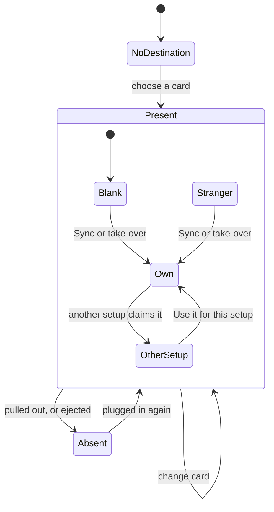
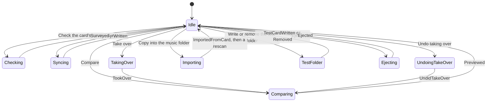
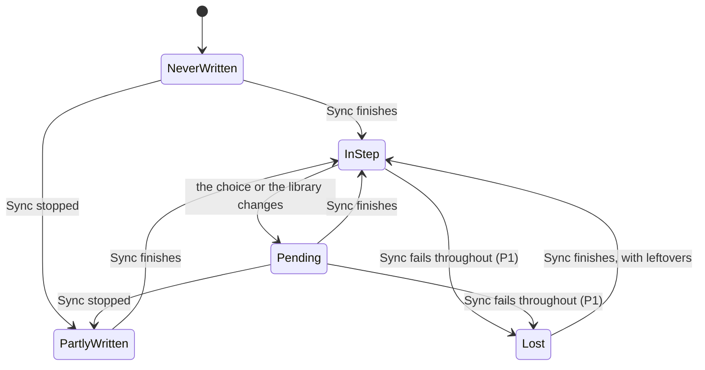
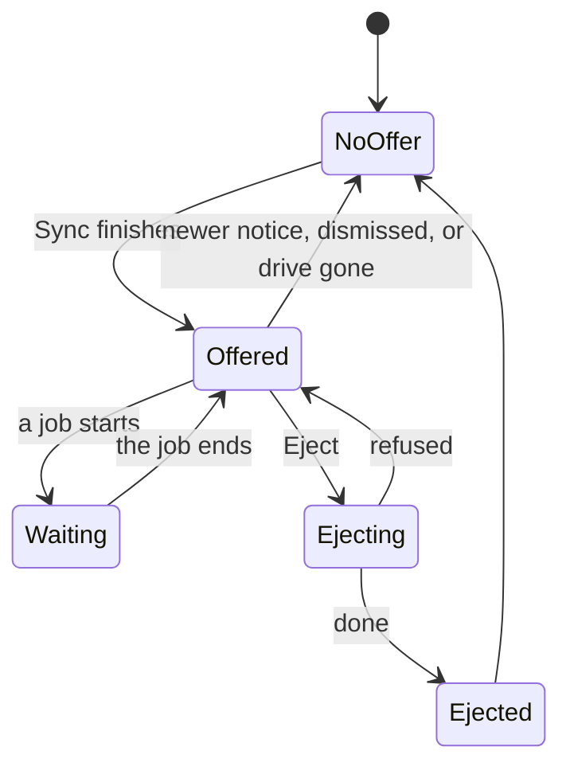

# The card as a state machine

Everything the app does with a removable card or stick: the states it can be in, what moves it
between them, and what each operation checks first. Written from the code on 2026-11-08, then
checked against it. [Section 7](#7-paths-not-handled-yet) lists the paths the code doesn't handle
yet.

"Card" means an SD card or USB stick; it can also be any folder chosen as the destination.

## 1. What the app knows about a card

A card has no identity of its own. The app knows a *path*, and what it finds there.

| What | Where it lives | Kept between runs | Set by |
|---|---|---|---|
| `dest`, where the setup writes | `WriteProfile` | yes | the card picker; `card_arrived` |
| `manifest`, the files this setup put there | `WriteProfile` | yes | end of a Sync; take-over and its undo |
| `last_written` | `WriteProfile` | yes | end of a Sync that wasn't stopped |
| `.pausetape`, the label: which setup last wrote the card | on the card | on the card | Sync; take-over; *Use it for this setup* |
| `volumes`, the drives listed now | `App` | no | `watch_cards`, and after Sync and Eject |
| `mounted`, the drives seen last time | `App` | no | `watch_cards` |
| `dest_label`, the label as last read | `App` | no | `refresh_label` |
| `write_preview`, the last comparison | `App` | no | Compare (`Msg::Previewed`) |
| `card_survey`, what's on the card besides this setup's files | `App` | no | Check (`Msg::Surveyed`) |
| `busy`, the job running | `App` | no | each job |
| `eject_notice`, the notice offering Eject, and the drive | `App` | no | `offer_eject`; `Msg::Ejected` |

A label names a *setup*, not a physical card. Two cards synced by one setup look the same.

`card::volumes` lists drives: `/Volumes` on macOS, `/media` and `/run/media` on Linux, and on
Windows removable and fixed drives other than Windows' own.

## 2. Machine A: the card, as a setup sees it

| State | Test in the code | What's allowed |
|---|---|---|
| NoDestination | `dest` is `None` | choose a card |
| Absent | `dest` set, `dest.exists()` false | choose a card; Sync and Compare are hidden |
| Blank | present, no label | everything |
| Own | label's id is this setup's | everything |
| OtherSetup | label names another setup on this computer (`refused_by_label`) | switch to it; relabel; Compare. No Sync, check or take-over |
| Stranger | label names a setup not on this computer | everything. Sync relabels it; only this setup's own files are ever removed |

`dest` is never cleared, only replaced. Which of these states applies is worked out when it's
needed; nothing stores it.

**Noticing a card.** Every 3 seconds `watch_cards` lists the drives. A drive not in `mounted`
whose top folder holds a label counts as arrived:

| Arrival | Result |
|---|---|
| Label's setup is here, app idle | `dest` follows the card; the setup comes up unless the active setup's own card arrived too; a notice says so |
| Label's setup is here, a job running | a notice only ([P4](#7-paths-not-handled-yet)) |
| Label's setup isn't here | a notice only |
| No label | nothing; the card is chosen in the picker |

**A card going away** has no event of its own. `volumes` loses it, `mounted` follows and the
views that test `dest.exists()` change. Nothing else is cleared ([P7](#7-paths-not-handled-yet)).

## 3. Machine B: the job slot

One job at a time, held in `busy`. Every job on the card takes the slot and gives it back when
its message arrives.

Library jobs (scan, tag writing, Trash) use the same slot, so none of these runs beside them.
Only Sync and Import can be stopped by the user. Replies name the setup by id, so switching
setups during a job is safe: a reply for another setup, or a deleted one, changes only that setup.

## 4. Machine C: what the record says about the card

The manifest is a claim about the card. This machine is about how far it can be trusted.

- **The order of a Sync** (`card::write`): label; rename what only changed name; remove what's no
  longer wanted; copy; playlists; remove what's left over; clean macOS files.
- **Stopped**: the song being copied finishes. The manifest is what was copied plus earlier
  entries still on the card, so the next Sync carries on and can still remove its own files.
- **Finished**: the manifest is what was written this time. `last_written` is set and, if the
  drive qualifies, Eject is offered.
- **Half a copy** can't sit under a song's name: `plain_copy` and `encode` write to `.partial`, then
  rename. If the copy fails, the partial file is removed.

## 5. Machine D: the Eject offer

| Rule | Where |
|---|---|
| Only after a Sync that wasn't stopped | `Msg::Written` |
| The drive holding `dest` must be listed | `offer_eject` |
| It must be ejectable: removable on Windows; any listed volume elsewhere | `platform::ejectable` |
| It can't hold the music folder | `offer_eject` |
| The offer lives as long as its notice is the latest and the drive is listed | `notice_offers_eject` |
| Greyed while a job runs, saying until when | `ui::notice` |
| A refusal keeps the offer, on the notice that says why | `Msg::Ejected` |

## 6. What each operation checks

| Operation | Slot free | Card connected | Label allows | Library ready |
|---|---|---|---|---|
| Sync | ✓ | interface only | ✓ | ✓ |
| Compare | interface only | interface only | not needed | not needed |
| Compare after the welcome's *Start* | no | no | not needed | not needed |
| Check the card's music | ✓ | **no** | ✓ | ✓ |
| Take over | ✓ | **no** | ✓ | ✓ |
| Undo taking over | ✓ | **no** | **no** | not needed |
| Copy into the music folder | ✓ | **no** | not needed | ✓ |
| Write the test folder | ✓ | ✓ | no (it only adds its own folder) | not needed |
| Remove the test folder | ✓ | no | no | not needed |
| *Use it for this setup* | **no** | no | it's the answer to it | not needed |
| Eject | ✓ | ✓ | not needed | not needed |
| Change card | **no** | not needed | read afterwards | not needed |

✓ is checked in the operation itself. "Interface only" means the button or shortcut checks, and
the function behind it doesn't. Sync's confirmation dialog goes straight to the function.

### What should always be true

| | Rule | Holds? |
|---|---|---|
| 1 | One job on the card at a time | Yes. Compare from *Start* can run beside a library job; it only reads |
| 2 | A reply changes only the setup it names | Yes, but a setup's `dest` can change meanwhile ([P3](#7-paths-not-handled-yet)) |
| 3 | Only files this setup recorded are removed, and only at the recorded size | Yes (`prune`) |
| 4 | Nothing outside the card follows from a record | Yes: `prune` and `relocate` check every path component |
| 5 | No half-written file under a song's name | Yes |
| 6 | A card that's another setup's here isn't synced or taken over | Yes, for what the label says |
| 7 | The manifest describes what's on the card | **No** ([P1](#7-paths-not-handled-yet)) |
| 8 | `dest` changes only while idle | **No**: `card_arrived` waits, the picker doesn't ([P3](#7-paths-not-handled-yet)) |
| 9 | A song already on the card stays there if its replacement fails | **No** ([P8](#7-paths-not-handled-yet)) |
| 10 | An undo record is used up only when it put things back | **No** ([P2](#7-paths-not-handled-yet)) |
| 11 | The music folder isn't inside the card folder, or the reverse | Yes (the picker). The same drive is allowed; it only loses the Eject offer |

## 7. Paths not handled yet

Most serious first. "Tested" means reproduced; "read" means found in the code and not run.

| | Path | What happens | Evidence | Direction |
|---|---|---|---|---|
| **P1** | Every write of a Sync fails: the card is pulled out, absent when the dialog is confirmed, or write-protected | It ends as if finished. The manifest is replaced by what was written (2 entries became 0), `last_written` is set, and the notice starts with "Done". Files from earlier Syncs stop being this setup's, and those no longer chosen are never removed. Songs still to convert are converted for nothing | Tested: a drive that isn't there. On macOS and Linux, whether `create_dir_all` could recreate a vanished mount path on the internal disk is not checked | Detect the missing card in the copy loop and end like a stop: keep entries still on the card, no `last_written`, no "Done" |
| **P2** | *Undo taking over* with the card absent or a different one in its place | Every move fails, and the record is still renamed `.undone`: the undo is spent having put nothing back. The link stays reachable through an old comparison | Read: `adopt::undo_latest` | Check the card first; mark it undone only if nothing failed |
| **P3** | *Change card* while a job runs | The picker isn't blocked. When a Sync ends, the old card's manifest lands on a setup pointing at the new card. A check that ends late leaves the old card's list ready to be applied to the new one | Read: `folders::pickers`, `Msg::Written`, `Msg::Surveyed` | Block the picker while busy, or have replies carry the `dest` they used |
| **P4** | A card arrives while a job runs, **which includes every launch with a library** (opening it takes the slot on the first frame) | `dest` isn't updated and the drive is recorded as seen, so it's never looked at again. At launch the notice wrongly says "plugged in". If the letter changed, the card reads as not connected while it's in. The "already where it's expected" case in `card_arrived` is rarely reached | Read: `watch_cards`, `card_arrived`, `App::load` | Don't record arrivals as seen until the slot is free |
| **P5** | The window is closed during a job | Nothing asks. The manifest isn't updated, a `.partial` can stay, and most of it mends at the next Sync. A take-over writes its undo record only at the end, so moves already made can't be undone | Read: no close handling; `adopt::take_over` | Ask before closing during a job; write the record as it goes |
| **P6** | A different card appears at the same path (swapped between polls, or chosen with *Change card*) | Anything without another setup's label counts as this setup's. The manifest, `last_written` and the take-over offer aren't reset. A Sync replaces the first card's record, whose files become foreign when it returns. `prune`'s size check keeps this from deleting unrelated files. More likely with Windows drive letters than with macOS volume names | Read: `sync`, `pickers` | A question of design: give each card its own id in the label, and tie the manifest to it |
| **P7** | The card goes away with a comparison or check on screen | `write_preview`, `card_survey` and `test_card` stay, with no notice. *Go through them* and *Undo* remain usable. Take-over reports errors, and uses up the check. Refused by a label, it also loses the check, where Import puts it back | Read | Clear them when the drive leaves; check the card in each operation |
| **P8** | A song that had to be replaced fails, for example if the music folder's drive goes during a Sync | The new copy fails; the old one, recorded at its size and not in the new list, is removed by the last clean-up. The song is off the card until the next Sync. `card::write` documents removing "songs that failed", but a working old copy goes with them | Read: `card::write`, `prune` | Keep the old entry when its replacement failed |
| **P9** | *Use it for this setup* during a job | Rewrites the label with no check, even mid-Sync | Read: `claim_card` | Take it only while idle |
| **P10** | A setup whose destination is a folder on the card | The label is in that folder, and arrival only reads the top of the drive, so plugging it in brings nothing up. If that folder doesn't exist, the first Sync reports "labelling the card" as a problem and goes on | Tested: the missing folder. Read: the arrival | Search from the setups' own `dest` too; create the folder first |
| **P11** | Card readers that can't eject the medium | Eject reports success once dismounted, on purpose. Then `dest.exists()` (each frame, in four places) and the label read may mount it again while the notice says it can come out | Read. A USB stick stayed gone for 15 s; no reader tried | Try one; stop looking at that drive after an Eject |
| **P12** | Reading the card on the interface thread | `exists()` and `space` each frame, the label every 3 s. A sleeping or failing drive stalls the window | Read | Move it to the watcher's own thread |
| **P13** | Switching setups during a Sync | The capacity bar shows the Sync's room on the setup now open. Display only | Read: `card_room` | Keep it with the setup id |

Not faults, but easy to miss:

- Eject is only offered after a Sync. The test folder's notice says to eject the card, with no button.
- USB hard disks count as fixed on Windows, so they get no Eject.
- A Stranger card is relabelled by a Sync with only a line of text beforehand.

## 8. What has been run on real hardware

Windows 11, a FAT32 USB stick, no administrator rights, 2026-11-08: two Syncs (4 copied, then 4
unchanged, read back in full); Eject refused with a file open, in about 2 s, with the retry
offered; Eject done in under a second; the drive stayed gone for 15 s with the watcher on; no
offer for an internal drive or the music folder's drive; greyed during a job. macOS: a FAT32 disk
image, ejected and refused.

The button itself was called from a test script rather than clicked. Not run: a card reader, an
Explorer window left open on the card, a Sync stopped and Eject checked after it, Linux.
